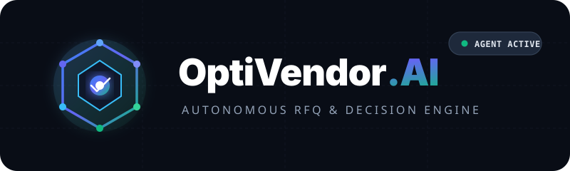
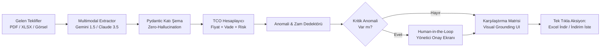

<div align="center">
  

  <br/><br/>

  <p align="center">
    <strong>Tedarikçi Teklif Karşılaştırma &amp; Otonom Satın Alma Karar Destek Ajanı</strong><br />
    <em>Autonomous RFQ Normalization, Visual Grounding &amp; TCO Intelligence Engine</em>
  </p>

  <p align="center">
    <a href="https://github.com/meryemgcl/optivendor-ai"></a>
    
    
    
    
  </p>
</div>

---

## 📌 Proje Vizyonu & Yönetici Özeti

**OptiVendor.AI**, işletmelerin tedarikçilerden farklı formatlarda (taranmış PDF, Excel, e-posta metni, WhatsApp fotoğrafı) aldığı teklifleri (RFQ) multimodal LLM'ler aracılığıyla otonom olarak toplayan, standart bir veri şemasına oturtan, **Görsel Doğrulama (Visual Grounding)** ile güven inşa eden ve Toplam Sahip Olma Maliyeti (TCO) hesaplayarak en karlı teklifi öneren yeni nesil kurumsal B2B yapay zeka platformudur.

Geleneksel "sohbet botları" yerine; katı kurallarla çalışan deterministik doğrulama, döngüsel hata onarımı ve **Human-in-the-Loop (İnsan Onayı)** kapılarına sahip kurumsal seviye bir sistem mimarisi sunar.

---

## 🌟 Öne Çıkan "Wow" Yetenekleri

* 🔍 **Görsel Doğrulama (Visual Grounding & Bounding Boxes):**  
  Çıkarılan fiyat veya miktar verisine tıklandığında, sol paneldeki orijinal teklif PDF'inde o kelimenin etrafı **parlayan sarı/yeşil bir kutucukla (Bounding Box)** aydınlanır. Halüsinasyon şüphesini sıfıra indirir.
* ⚖️ **Akıllı TCO & Finansman Analizi:**  
  Sadece net fiyata bakmaz; vade gününe (90 gün vadeli teklifin nakit akışı avantajı), teslimat süresine ve nakliye şartlarına göre ağırlıklı **Toplam Sahip Olma Maliyeti** çıkarır.
* ⚠️ **Fiyat Artış & Anomali Dedektörü:**  
  Geçmiş alım hafızasına kıyasla %15+ zamlanan kalemleri derhal sarı alarm olarak işaretler.
* ✍️ **Stratejik Pazarlık & Karşı Teklif Asistanı:**  
  Tedarikçiye gönderilmek üzere, rakip firma isimlerini gizli tutarak taviz isteyen kurumsal indirim talep e-postalarını tek tıkla üretir.
* 🛡️ **Human-in-the-Loop (HITL) Güvenlik Kapısı:**  
  Ajan kritik anomalilerde veya düşük güven skorlarında `interrupt()` ile durur, durumunu PostgreSQL'e kaydeder ve satın alma yöneticisinin onayından sonra süreci tamamlar.

---

## 🏗️ Sistem Mimarisi & Veri Akışı



---

## 🗂️ Modüler Dizin Mimarisi

```
OptiVendor-AI/
├── .github/
│   └── copilot-instructions.md      # GitHub Copilot küresel sistem talimatları
├── assets/                          # Vektörel SVG marka varlıkları
│   ├── logo.svg                     # Kurumsal logo (Durum rozetli)
│   └── icon.svg                     # Vektörel favicon
├── docs/                            # Mimari dokümantasyon
│   ├── architecture.md              # Mermaid şemaları, OOP sınıf şeması & TCO formülü
│   ├── personas.md                  # Satın Alma Müdürü, CFO ve Saha Şefi analizleri
│   └── lovable_guidelines.md        # Tasarım sistemi, dark mode ve glassmorphism
├── prompts/                         # Standart Profesyonel Prompt Koleksiyonu
│   ├── 01_faz1_ui_skeleton_prompts.md
│   ├── 02_faz2_extraction_and_graph_prompts.md
│   ├── 03_faz2_negotiation_anomaly_prompts.md
│   ├── 04_faz3_testing_and_benchmarking_prompts.md
│   └── 05_faz4_copilot_and_system_archive_prompts.md
├── core/                            # Python Backend & LangGraph Motoru
│   ├── schemas/quote_schema.py      # Pydantic veri modelleri & BoundingBox
│   ├── services/tco_calculator.py   # Finansman ve termin riski hesaplayan TCO motoru
│   └── requirements.txt             # Backend bağımlılıkları
├── web/                             # Next.js 14 App Router Frontend (Glassmorphic)
│   ├── app/                         # App Router sayfaları ve layout
│   ├── components/layout/           # Split View, Header, Matrix, Action Drawer
│   └── public/assets/               # Logo ve statik varlıklar
├── COPILOT_DEVELOPMENT_PLAYBOOK.md  # Copilot için adım adım İngilizce geliştirme kılavuzu
├── Yapilacaklar.md                  # Master görev takip listesi
└── README.md
```

---

## 🚀 Hızlı Başlangıç (Quick Start)

### 1. Frontend Kurulumu (Next.js 14)
```bash
cd web
npm install
npm run dev
```
Tarayıcınızda [http://localhost:3000](http://localhost:3000) adresine giderek modern Dark Glassmorphic paneli görüntüleyebilirsiniz.

### 2. Backend Kurulumu (Python 3.11+)
```bash
cd core
python -m venv .venv
# Windows:
.venv\Scripts\activate
# Linux/macOS:
source .venv/bin/activate

pip install -r requirements.txt
```

---

## 🤖 GitHub Copilot ile Geliştirme

Proje kökündeki [`COPILOT_DEVELOPMENT_PLAYBOOK.md`](COPILOT_DEVELOPMENT_PLAYBOOK.md) dosyasını açarak faz bazında hazırlanmış İngilizce promptları sırayla Copilot Chat'e aktarabilir, `.github/copilot-instructions.md` kuralları ışığında sistemi adım adım büyütebilirsiniz.

---

## 📜 Lisans & Standartlar
Bu proje **Clean Architecture**, **Twelve-Factor App** ve kurumsal veri gizliliği standartlarına uygun olarak tasarlanmıştır.

**Geliştirici:** [Meryem Güçlü](https://github.com/meryemgcl)
