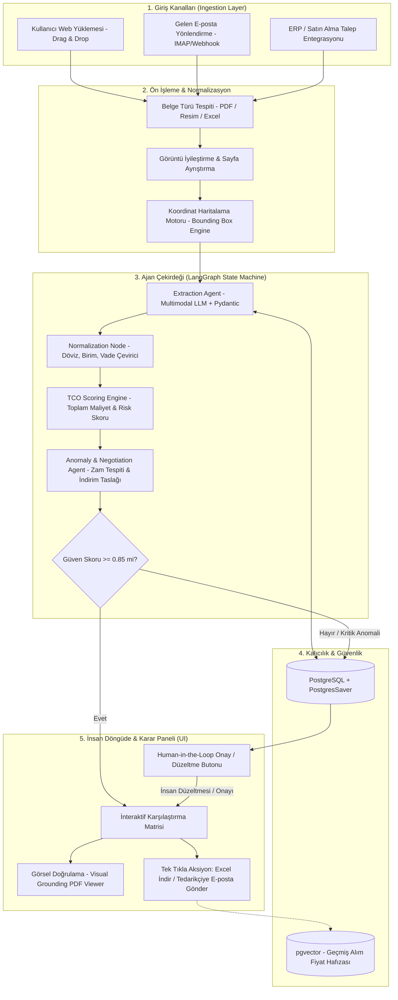
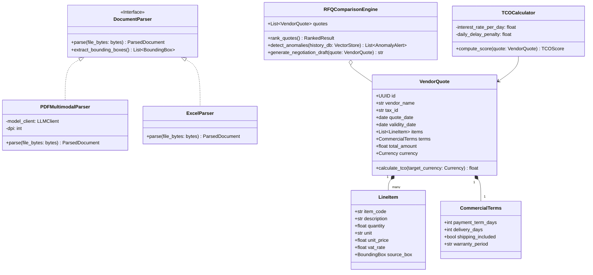

# 🏛️ OptiVendor.AI - Sistem Mimarisi & Teknik Tasarım Dokümanı

> **Doküman Versiyonu:** 1.0.0  
> **Hedef:** Kurumsal Seviye, Güvenli, Ölçeklenebilir ve Modüler B2B Karar Destek Ajanı

---

## 1. Yüksek Düzey Mimari Şeması (High-Level Architecture)

Aşağıdaki Mermaid şeması; farklı kanallardan (Web Upload, E-posta, WhatsApp) gelen tekliflerin sisteme girişinden nihai satın alma kararına kadar olan veri akışını gösterir:



---

## 2. Nesne Yönelimli Sınıf Akışı (OOP Class Flow)

Sistemin Python backend katmanında temiz kod ve SOLID prensiplerine uygun olarak tasarlanan temel sınıf yapısı:



---

## 3. Pydantic Katı Veri Şeması (Zero-Hallucination Schemas)

```python
from pydantic import BaseModel, Field
from typing import List, Optional
from datetime import date
from enum import Enum

class Currency(str, Enum):
    TRY = "TRY"
    USD = "USD"
    EUR = "EUR"

class BoundingBox(BaseModel):
    page_number: int = Field(description="1-based sayfa numarası")
    x_min: float = Field(description="Normalize edilmiş sol koordinat (0.0 - 1.0)")
    y_min: float = Field(description="Normalize edilmiş üst koordinat (0.0 - 1.0)")
    x_max: float = Field(description="Normalize edilmiş sağ koordinat (0.0 - 1.0)")
    y_max: float = Field(description="Normalize edilmiş alt koordinat (0.0 - 1.0)")

class QuoteLineItem(BaseModel):
    item_name: str = Field(description="Teklif edilen malzeme veya hizmet adı")
    quantity: float = Field(description="Teklif edilen miktar")
    unit: str = Field(description="Birim (Adet, Kg, Metre, Saat vb.)")
    unit_price: float = Field(description="KDV hariç birim fiyat")
    vat_rate: float = Field(default=20.0, description="KDV oranı (%)")
    bounding_box: Optional[BoundingBox] = Field(default=None, description="Metnin belgedeki görsel konumu")

class CommercialTerms(BaseModel):
    payment_terms_days: int = Field(default=0, description="Vade süresi (gün). 0 = Peşin")
    delivery_lead_time_days: int = Field(description="Teslimat süresi (iş günü)")
    shipping_included: bool = Field(default=True, description="Nakliye fiyata dahil mi?")
    notes: Optional[str] = Field(default=None, description="Özel iskonto veya şartlar")

class VendorQuoteSchema(BaseModel):
    vendor_name: str = Field(description="Teklifi veren firma ticari unvanı")
    tax_number: Optional[str] = Field(default=None, description="Vergi kimlik numarası")
    quote_date: Optional[date] = Field(default=None, description="Teklif düzenleme tarihi")
    currency: Currency = Field(description="Teklif para birimi")
    line_items: List[QuoteLineItem] = Field(description="Teklif kalemleri")
    commercial_terms: CommercialTerms = Field(description="Ticari ve teslimat şartları")
    confidence_score: float = Field(description="LLM çıkarma güven skoru (0.0 - 1.0)")
```

---

## 4. TCO (Toplam Sahip Olma Maliyeti) Hesaplama Algoritması

En ucuz teklif her zaman en karlı teklif değildir. OptiVendor.AI aşağıdaki matematiksel modeli uygular:

$$\text{TCO} = \text{Net Teklif Fiyatı} + \text{Finansman/Vade Maliyeti} + \text{Gecikme/Termin Riski Maliyeti} + \text{Nakliye/Ek Masraflar}$$

* **Vade Avantajı:** 90 gün vadeli 100.000 TL teklif, peşin 95.000 TL tekliften yüksek faiz ortamında daha karlı olabilir.
* **Gecikme Riski:** Fabrikanın üretim bandını durduracak 5 günlük bir gecikmenin maliyeti, 2.000 TL'lik malzeme indiriminden çok daha büyüktür.
* **Anomali Skoru:** Benzer malzeme son 6 ayda ortalama 100 TL'ye alınmışken gelen 135 TL'lik teklif derhal sarı alarm olarak işaretlenir.
